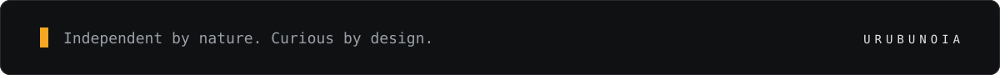

  

  <b>Independent tech builder</b> · AI · Automation · Linux · Open Source

  I experiment, learn, and turn ideas into tools that actually run. 
  Most of what I build starts with a real problem, often one of my own.

 

## ◆ Areas of Interest

- **Artificial Intelligence & Agents.** How language models reason, use tools and take actions, and how to make agents do useful work instead of just chatting.
- **Local AI.** Running open models on my own hardware for privacy, control and offline use.
- **Automation.** Scripts, bots and workflows that take repetitive work off the table.
- **Linux & the command line.** Learning the system from the inside and building on top of it.
- **Open Source.** Reading public code, learning from it, and sharing back what I make.

## ◆ What I Build

Practical, focused tools. Every project here should:

- **solve a real problem** — something I or someone else actually needed;
- **run locally when possible** — no unnecessary cloud, accounts or API bills;
- **be documented** — clear enough for someone else to install and use;
- **start small** — ship a working version first, then improve it through real use.

Typical shapes: command-line utilities, automations and bots, local AI experiments, and small integrations that connect tools that weren't built to talk to each other.

## ◆ Current Mission

Things I'm working towards right now:

- [ ] Publish my first open-source tools here, with proper documentation
- [ ] Build a local AI assistant that helps with Linux commands, with confirmation before anything runs
- [ ] Learn agent design: tool use, memory, and human approval for critical actions
- [ ] Get stronger at Python, Git and workflow automation
- [ ] Document what I learn along the way

## ◆ Principles

- **Curiosity first.** Understand how something works before trusting it.
- **Experiment.** A small test teaches more than a long plan.
- **Practical results.** If it doesn't run, it doesn't count.
- **Continuous improvement.** Version one is a starting point, not the finish line.

## ◆ Projects

Public projects are pinned below as they ship. No placeholders, no demos of things that don't exist.

<!--
  HOW TO ADD A PROJECT (keep this block hidden until there is something real to show)

  ### project-name
  One sentence: the problem it solves.
  `Status: experimental | usable | stable` · Built with: Python, Ollama, ...
  → https://github.com/urubunoia/project-name
-->

 

  

  <b>Observe. Learn. Build.</b>

